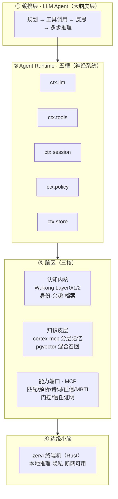

# 新一代智能大脑架构设计（研讨稿）

> **版本**：v0.2 · **日期**：2026-09-03 · **状态**：待 GenLTD 团队评审
> **面向**：GenLTD 全体成员（研发 / 产品 / 设计）
> **关联**：`CATALOG.md`（仓库血缘总索引）· steedar《AGENT_RUNTIME_PLUGIN_SLOTS》· Tatha《架构_单入口与中央大脑》· `D:/Kailash/cortex-mcp`

---

## 1. 摘要

当初各项目（Wukong、72changes、Looma、Tatha、go-zervi 等）都怀有同一个愿景——**用「拼接」的方式形成一个「智慧大脑」，统一调度各类能力**。但由于当时 AI 能力有限，最终只落地为「关键词意图分类 + if-else 分发」，大脑停留在"网关 + 转发器"层面。

本文提出**新一代智能大脑**的架构设计：以 **Wukong Layer0/1/2 共识 schema 为认知本体（世界模型）**、**分层记忆（cortex-mcp 承接 72changes RAG）为知识皮层**、**Agent Runtime 五槽为神经系统**、**LLM Agent 为编排皮层**，把全部能力端口 MCP 化后，实现一个**有认知、有记忆、能自主规划**的智能体。目标是让「拼接」真正升级为「认知」。

---

## 2. 背景与问题定义

### 2.1 历史脉络（从各仓文档中还原）

| 阶段 | 代表实现 | 形态 | 局限 |
|---|---|---|---|
| 构想期 | go-zervi「中央大脑」六层架构 | 智能理解/翻译/校验/生成/优化/学习层 | 仅落地网关+格式转换，PPT 级构想 |
| 落地期 | Tatha `central_brain` | 单入口 `POST /v1/ask` → 意图解析 → 分发 5 能力 | 意图仅 5 种，硬编码 dispatch |
| 插件化 | steedar 五槽 Agent Runtime | ctx.llm/tools/session/policy/store 研讨稿 | 未落地 |
| IoT 侧 | YeDall3.0 `ai-brain-service` | DeepSeek 对话 + MCP + 场景 API | 领域单一，未全局收敛 |

### 2.2 当初的核心卡点

1. **意图识别靠枚举**：关键词规则 + 窄 LLM，只能处理 5 种固定意图，无法应对开放需求。
2. **能力耦合在代码里**：`dispatch` 长函数硬编码，新增能力必须改代码、改路由。
3. **无记忆无规划**：无多轮上下文、无多步推理、无反思，一次问答即终结。
4. **认知结构缺失**：各能力各自定义数据模型，缺少统一的"用户/关系"认知本体（Wukong 的 Layer0/1/2 本应承担此责，却未接入）。

---

## 3. 核心设计理念

> **把 Wukong 的认知结构、分层记忆（72changes 的延续）、所有能力端口，用一个可插拔的 Agent Runtime 编排成一个"有认知、有记忆、能自主规划"的大脑。**

三个关键词：

- **认知（Cognition）**：Wukong Layer0/1/2 作为统一的"人-兴趣-关系"世界模型，所有工具读写对齐它。
- **记忆（Memory）**：分层认知记忆按物理三层就近分布（设备·边缘·场景，见决策⑦）；cortex-mcp 提供记忆机制；ctx.session 提供会话记忆。
- **自主（Agency）**：LLM Agent 通过 Function Calling 自主规划工具调用链，而非预枚举意图。

---

## 4. 与 DeepSeek Harness 的差异化定位

### 4.1 渊源

本设计的「五槽 Runtime + 工具 MCP 化」与 DeepSeek Harness（CLI `dsh`，2026-08-13 开源，MIT，基于 Cordis 微内核）的「一切皆插件」思想同源——steedar《AGENT_RUNTIME_PLUGIN_SLOTS》开篇即声明「对标 DeepSeek Harness」。

### 4.2 差异：如何组装 vs 认知什么

| 维度 | DeepSeek Harness | 本设计（Wukong 认知内核） |
|---|---|---|
| 定位 | 通用 Agent 底座（类比 npm / Node） | 领域认知本体 |
| 解决 | 如何组装（模型/工具/循环可替换） | 组装起来后认知什么 |
| 内容 | llm / tools / session / loop / sandbox | Layer0/1/2 身份·兴趣·档案、隐私分级、跨境门控 |
| 通用性 | 与业务无关，谁都能用 | GenLTD 独有 |

> Harness 是「积木底座」——保证能任意换模型/工具/循环，但不会告诉大脑「用户是谁（L0）、喜欢什么（L1）、什么背景（L2）、数据如何合规跨境」。这套认知结构正是 Wukong 的价值与 GenLTD 的护城河。

### 4.3 结论：不重造 Harness，而是站上 Harness

1. **通用 Runtime 直接采用** DeepSeek Harness（或 LangGraph 等同类），不自研 Cordis。
2. **GenLTD 的投入聚焦 Harness 没有的部分**：Wukong 认知本体 + 领域 MCP 工具（匹配/诗词/征信/MBTI）+ 合规门控 + 边缘小脑。
3. 与 steedar 研讨稿 §6 结论一致：借鉴「一切皆插件」思想，生产 Runtime 保持 Python，先进程内 Registry，Cordis 仅作实验参考。

---

## 5. 架构总览

### 5.1 分层架构图

### 5.2 各层职责

| 层 | 职责 | 明确不做 |
|---|---|---|
| 编排层 LLM Agent | 意图理解、任务规划、工具调用编排、反思与重试 | 不做业务数据读写 |
| Agent Runtime 五槽 | 提供 llm/tools/session/policy/store 五类能力供给 | 不解析业务意图 |
| 认知内核（Wukong） | Layer0/1/2 世界模型、隐私分级、跨境门控、共识评分、认知偏差检测 | 不做模型推理 |
| 知识皮层（cortex-mcp） | 四类记忆（工作/情景/语义/程序）、混合召回、巩固遗忘 | 不做业务决策 |
| 能力端口（MCP） | 各领域具体能力（匹配/解析/诗词/征信/MBTI…） | 不做鉴权（交给 policy） |
| 边缘小脑（zervi） | 本地低延迟、隐私敏感任务、断网可用 | 不做全局聚合 |

---

## 6. 八大设计决策

### 决策① 编排层：用 Agent 取代规则意图分类

- **现状**：Tatha `parse_intent` 仅 5 种意图 + 关键词回退，属"窄 AI"。
- **目标**：改为 LLM Agent + Function Calling，大脑自主决定调用哪个工具、几次、如何组合、是否反思。
- **收益**：意图不再枚举，开放需求由规划解决；新增能力无需改意图表。

### 决策② 认知内核：Wukong Layer0/1/2 = 大脑世界模型

- **现状**：`YeDall3.0.1/zervi-looma`（Rust）已实现隐私分级（L0_PII）、跨境门控（CN/EU/SG）、共识评分（Jaccard 加权，103 源）。
- **目标**：将其定为唯一认知本体，所有工具的数据读写对齐 Layer0（身份）/1（兴趣）/2（档案）canonical 字段。
- **收益**：大脑对"用户是谁、喜欢什么、什么背景"有统一认知，跨能力共享画像。

### 决策③ 知识皮层：72changes RAG = 长期记忆

- **现状**：72changes 源码不在本备份，但 `DemoPeter`（Flask + Chroma）是其 Python 复刻且功能完整（文档管道、向量检索、RAG、报告）。
- **升级选型**：`cortex-mcp`（`D:/Kailash/cortex-mcp`）已把 DemoPeter RAG 升级为「分层认知记忆 MCP 服务」——四类记忆（working/episodic/semantic/procedural）+ pgvector 混合检索（向量+FTS RRF）+ 元认知巩固（remember/recall/forget/consolidate 四个 MCP 工具），是知识皮层/记忆层的**推荐实现**。
- **目标**：以 cortex-mcp 作为 `ctx.store` 的记忆实现，并把记忆 metadata 对齐 Wukong Layer0/1/2 canonical 字段（记忆机制 × 认知本体结合）。
- **收益**：大脑具备可检索、可巩固、可遗忘的分层记忆；记忆结构与认知本体对齐，跨能力共享画像有据可依。

### 决策④ 五槽 Runtime 落地

- **现状**：steedar《AGENT_RUNTIME_PLUGIN_SLOTS》已给出五槽契约与现有代码映射。
- **目标**：将研讨稿落成 ADR 与实现；`ctx.policy` 直接对接 zervi-looma 的合规/隐私分级。
- **收益**：能力解耦、可插拔、可替换（llm/provider 回退、store 切换）。

### 决策⑤ 能力端口全部 MCP 化

- **现状**：Tatha/looma 的 agents（job_match/resume_parse/poetry/credit/mbti/trust）已实现，但以同仓函数存在。
- **目标**：全部注册为 MCP 工具，REST 与 MCP 共用同一实现，MCP 只做传输适配。
- **收益**："拼接"变"插拔"——新增能力 = 加一个 MCP server，不动大脑。

### 决策⑥ 边缘小脑 + 中央大脑分层

- **现状**：zervi-rust / go-zervi 框架已有，可承载边缘运行时。
- **目标**：zervi 终端机跑轻量 Agent，处理隐私敏感、低延迟任务；云端跑全量 Agent。
- **收益**：敏感数据（本地 L0 PII）留边缘，聚合决策上云；契合 Wukong 数据门控/跨境合规叙事。

---

### 决策⑦ 记忆物理分层：设备 · 边缘 · 场景三层就近分布

- **原则**：记忆不是「带在身边的硬盘」，而是按数据主权 + 就近原则，把「实体·边·事件」图谱分布到三层物理空间（区别于业界 MemGPT / Zep 的单机/云端集中式记忆）。
- **设备层（穿戴设备）**：工作记忆——当前场景上下文、传感器流，数据不出设备。
- **边缘层（边缘节点）**：情景记忆 + 个人语义记忆——个人完整图谱（实体·边·事件），本地存储，PIPL 合规，断网可用。
- **场景层（云端）**：共识语义记忆 + 程序记忆——脱敏后的共识子图，走 Wukong 门控，用于跨境匹配与共识评分。
- **上浮 / 下沉机制**：数据默认留设备/边缘；仅「需跨场景共识 + 已脱敏」的数据上浮云端；云端按需下沉拉取边缘上下文（不常驻）。
- **收益**：数据主权明确，L0 PII 永不出边缘；记忆图谱就近分布，低延迟 + 合规 + 断网可用三赢。

---

### 决策⑧ 认知偏差检测：黑匣子双组件（认知内核的质量保障）

- **命题**：「认知是否正确」与「认知是什么（Layer0/1/2）」是认知内核的两面，缺一不可。世界模型定义认知结构，偏差检测保障认知不漂移。
- **设计理念**：参考民用航空黑匣子（FDR + CVR），用两个组件确保认知质量：
  - **组件① 现场处置校验（实时 · 事前防偏）**：每次行为比对规范（Layer0/1/2 canonical + 门控规则）才放行，对应 `ctx.policy` + zervi-looma 门控。
  - **组件② 记录 + 大数据比对（异步 · 事后纠偏）**：完整记录远端声音（感知输入）/ 操作（工具调用）/ 指令（决策），事后与共识数据、历史模式比对，检测认知漂移，对应追记式日志 + 冲突消解 + 元认知。
- **与三层分布贯通**：黑匣子记录在远端（设备/边缘），大数据比对在云端/中心——端云协同，数据不全部回传。
- **务实边界**：本组件暂无成熟实践标准，需先搭记录框架、边跑边积累偏差案例，靠实践与时间验证（类比航空黑匣子几十年才成熟）。zervi-looma 现有约 80% 是「认知是什么」，剩余 20% 的「认知偏差检测」无法纸上谈兵，必须落地运行后逐步补全。

---

## 7. 现有资产映射

| 新架构层 | 复用现有资产 | 状态 |
|---|---|---|
| 编排层 Agent | Tatha `central_brain` | 有基础，需升级为 Agent loop |
| 五槽 Runtime | steedar `AGENT_RUNTIME_PLUGIN_SLOTS.md` | 需落地（ADR + 实现） |
| 认知内核 | `YeDall3.0.1/backend/crates/zervi-looma`（Rust） | 已实现约 80% |
| 知识皮层 | `cortex-mcp`（pgvector 分层记忆 + MCP，DemoPeter 升级版） | 已有骨架（M0 完成） |
| 能力端口 | Tatha / looma-zervi 的 agents | 已实现，需 MCP 化 |
| 边缘小脑 | zervi-rust / go-zervi | 框架已有 |

> 注：Wukong Python 源码、72changes Spring Boot 源码不在本备份，需从原始机器或历史 git 找回，或按上述映射以现有复刻替代。

---

## 8. 四阶段演进路径

| 阶段 | 目标 | 关键动作 | 交付物 |
|---|---|---|---|
| **P1 认知对齐** | 定唯一认知本体 | 锁定 Wukong schema；zervi-looma 门控落为 `ctx.policy` | 认知本体规范 + policy 接入 |
| **P2 工具 MCP 化** | 能力可插拔 | 8+ 能力端口注册 MCP；cortex-mcp 记忆接入 ctx.store | MCP 工具注册表 + 调用 demo |
| **P3 Agent 编排** | 从规则到自主 | `central_brain` 升级为规划+反思循环；加 `ctx.session` 记忆 | Agent loop + 记忆层 |
| **P4 边缘小脑** | 端云协同 | zervi 终端机跑本地 Agent；断网可用 + 隐私本地化 | 边缘运行时 + 端云路由 |

---

## 9. 关键技术选型（建议）

| 层 | 选型 | 备选 | 说明 |
|---|---|---|---|
| 编排层 | Python + LLM Agent 框架（LangGraph / PydanticAI） | DeepSeek Harness / LiteLLM 直连 | 与 Tatha 现栈一致；通用底座借鉴 Harness，不重造 |
| Runtime | Python（生产） | TypeScript/Cordis（实验） | 保持 Python，避免过度工程 |
| 网关/认证 | go-zervi（Go）或 zervi-rust（Rust） | Nginx/Kong | 自主可控，JWT/OAuth2/RBAC |
| 认知内核 | Rust `zervi-looma` | — | 已实现，门控/共识/合规 |
| 知识皮层 | cortex-mcp（pgvector 四类记忆 + 混合检索 + MCP） | Mem0 / Zep Graphiti / Letta | 分层认知记忆，含巩固/遗忘 |
| 工具协议 | MCP（Model Context Protocol） | 自研 REST | 标准化，工具可插拔 |
| 边缘 | zervi-rust（Tauri/单二进制） | go-zervi | 适合树莓派/边缘，无运行时 |

---

## 10. 风险与开放问题（研讨点）

1. **认知本体落地边界**：Wukong Layer0/1/2 是"数据共识"schema，直接做"认知本体"是否过重？是否需要轻量层适配？（研讨：先最小可用 L0 还是全量？）
2. **Agent loop 复杂度**：自主规划 vs 可预测性的权衡，如何保证关键路径（如征信、合规）确定性？（研讨：哪些意图强制走规则，哪些放开给 Agent？）
3. **边缘小脑的模型能力**：本地 LLM 能力有限，边缘能承担多少任务？（研讨：本地只做隐私过滤+意图粗筛，复杂推理上云？）
4. **Wukong 源码缺失**：认知内核依赖 zervi-looma（Rust 重实现），但 Wukong 原始 Python 管线（backup_analyzer.py 等）缺失，是否需要找回？（研讨：找回 vs 以 Rust 重实现为准）
5. **五槽命名与范围**：`session` 是否拆分"会话/记忆"两槽？叙事 Act1 是否独立第六槽？（研讨：沿用 steedar 研讨稿 §7 决策题）
6. **记忆层选型**：cortex-mcp（自研可控）vs Mem0 / Zep Graphiti / Letta（成熟框架）如何取舍？（研讨：见 §11 业界参考，先自研跑通再评估迁移）

---

## 11. 业界参考实践（供团队学习）

> 我们的架构并非凭空设计，每一层都能在业界找到成熟实践与前沿研究。以下按架构层归类，标注「借鉴点」。

### 11.1 记忆层（对应知识皮层 / ctx.session）

| 流派 | 代表项目 | 核心思想 | 对我们的借鉴 |
|---|---|---|---|
| 自动记忆抽取 | Mem0（40K★，$24M 融资） | LLM 抽取事实，向量+图双存储，三级隔离 | 即插即用，抽取层思路 |
| 时序知识图谱 | Zep / Graphiti | bi-temporal，事实随时序演化，多跳推理 | 冲突消解、时间旅行 |
| OS 式虚拟记忆 | Letta（原 MemGPT） | Core/Archival/Recall 三层，Agent 自编辑 | 记忆分层、自主管理 |
| 自组织记忆 | A-MEM（NeurIPS 2025） | Zettelkasten 索引 + 巩固 + 演化 | 最接近人脑，巩固机制 |
| 记忆 SDK | LangMem | Semantic/Episodic/Procedural 三分 | 四类记忆行业语言 |
| 结构化笔记 | Claude Memory Tool | /memories 目录，可审计/删除/迁移 | 记忆可控、可迁移 |

**关键结论**：
- cortex-mcp 的「四类记忆（working/episodic/semantic/procedural）」正是行业通用语言，方向正确。
- 「记忆分层」是共识（Letta 三层 / 缓存隐喻 L1/L2/L3）；「Memory Graph（实体+边+事件）」是第三代趋势，比纯向量 RAG 强（85-95% vs <60%）。
- 「巩固 + 遗忘」是前沿（A-MEM、cortex consolidate），这正是我们记忆层的差异化点。
- 长上下文是 RAM、长期记忆是硬盘，两者不可替代（Context Rot 实验：128K 塞满反而准确率掉到 64%）。
- 但业界 Memory Graph 多为**集中式**（单机/云端大图）；GenLTD 的穿戴+隐私+跨境场景需做**分布式**（按数据主权就近分布三层，见决策⑦）——这是我们的差异化。

### 11.2 MCP 生态（对应能力端口 MCP 化）

| 项目 | 说明 | 借鉴点 |
|---|---|---|
| 官方 Memory server | 知识图谱 + JSONL，9 工具 | MCP 记忆参考实现 |
| Dakera MCP Memory | 14 core（86+ 全量），Rust 单二进制 | 工具分层（core/power） |
| OpenMemory（Mem0） | Mem0 的本地 MCP server | 记忆即插即用 |
| codebase-memory-mcp | 代码库→知识图谱，Token 降 ~120× | 对应「代码索引」能力 |
| SequentialThinking | 可见的逐步推理 | 编排层可参考 |

**关键结论**：MCP 记忆服务已是成熟生态，印证决策⑤「能力 MCP 化」是正确方向；cortex-mcp 走的就是这条路线。

### 11.3 认知架构理论（对应认知内核）

- 经典认知架构 **SOAR / ACT-R / CLARION**（五十年积累）：模块化记忆（declarative/procedural）+ 目标管理 + 学习机制，是「认知内核」的理论源头。
- 现代 LLM 认知架构五层：感知 → 记忆 → 推理 → 行动 → 学习。
- **Forms-Functions-Dynamics** 框架：记忆的「表示 / 功能 / 演化」三维度，可用来设计 Wukong Layer0/1/2 与记忆的结合。

**关键结论**：Wukong Layer0/1/2 作为「世界模型/认知本体」，对应认知架构里的「长期记忆 + 世界模型」；cortex-mcp 四类记忆对应「记忆机制」；两者正交结合是符合认知科学的设计。

---

## 12. 附录

### 12.1 术语表

| 术语 | 含义 |
|---|---|
| Wukong | 跨境数据共识匹配平台，Layer0/1/2 共识 schema 的源头 |
| 72changes | Wukong 工作区的 RAG 知识库子项目（Spring Boot） |
| cortex-mcp | 分层认知记忆 MCP 服务（DemoPeter RAG 的升级版） |
| 中央大脑 / Central Brain | 意图解析 + 能力分发的调度中枢 |
| Layer0/1/2 | 身份(identity)/兴趣(interest)/档案(profile) 三层共识 schema |
| 五槽 | ctx.llm / tools / session / policy / store |
| MCP | Model Context Protocol，标准化工具调用协议 |
| zervi-looma | YeDall3.0.1 的 Rust 数据门控语义层 |

### 12.2 血缘索引

- 详细仓库血缘见 `CATALOG.md`（含「七、Wukong 血缘」专节）。
- 智慧大脑演进脉络的三份关键源文档：
  - go-zervi《🧠Go-Zervi核心价值与中央大脑定位》
  - Tatha《架构_单入口与中央大脑》
  - steedar《AGENT_RUNTIME_PLUGIN_SLOTS》
- 记忆层参考实现：`D:/Kailash/cortex-mcp`

---

*本文档为研讨稿，所有「决策」与「选型」均待团队评审后定稿。*
